# Image-Handling-and-Pixel-Transformations-Using-OpenCV 
**Name** : SUSHMITHA S

**Reg. No**: 212224230282

**EX**: 01

## AIM:
Write a Python program using OpenCV that performs the following tasks:

1) Read and Display an Image.  
2) Adjust the brightness of an image.  
3) Modify the image contrast.  
4) Generate a third image using bitwise operations.

## Software Required:
- Anaconda - Python 3.7 / Python 3.x
- Jupyter Notebook (for interactive development and execution)

## Algorithm:
### Step 1:
Load an image from your local directory and display it.

### Step 2:
Create a matrix of ones (with data type float64 / uint8) to adjust brightness.

### Step 3:
Create brighter and darker images by adding and subtracting the matrix from the original image.  
Display the original, brighter, and darker images.

### Step 4:
Modify the image contrast by creating two higher contrast images using scaling factors of 1.1 and 1.2.  
Display the original and higher contrast images.

### Step 5:
Split the image into B, G, R components and display the channels. Perform merging for RGB and HSV representations.

### Step 6:
Perform bitwise operations (e.g., bitwise AND with a mask) to generate a third image.

## Program Developed By:
- **Name:** SUSHMITHA S
- **Register Number:** 212224230282

### Ex. No. 01

#### 1. Read the image ('sunflower.jpg') using OpenCV imread() as a color image.
```python
import cv2
import numpy as np
import matplotlib.pyplot as plt

img = cv2.imread('sunflower.jpg', cv2.IMREAD_COLOR)
img_rgb = cv2.cvtColor(img, cv2.COLOR_BGR2RGB)
```

#### 2. Print the image width, height & Channel.
```python
img.shape
```

#### 3. Display the image using matplotlib imshow().
```python
img_gray = cv2.cvtColor(img_rgb, cv2.COLOR_RGB2GRAY)
plt.imshow(img_gray, cmap='gray')
plt.show()
```

#### 4. Save the image as a PNG file using OpenCV imwrite().
```python
cv2.imwrite('sunflower_saved.png', img)
```

#### 5. Read the saved image above as a color image using cv2.cvtColor().
```python
img = cv2.imread('sunflower_saved.png')
img_rgb = cv2.cvtColor(img, cv2.COLOR_BGR2RGB)
```

#### 6. Display the Colour image using matplotlib imshow() & Print the image width, height & channel.
```python
plt.imshow(img_rgb)
plt.show()
img.shape
```

#### 7. Crop the image to extract any specific (Sunflower alone) object from the image.
```python
crop = img_rgb[280:620, 130:460]
plt.imshow(crop)
plt.title("Cropped Region")
plt.axis("off")
plt.show()
crop.shape
```

#### 8. Resize the image up by a factor of 2x.
```python
res = cv2.resize(crop, (crop.shape[1] * 2, crop.shape[0] * 2))
```

#### 9. Flip the cropped/resized image horizontally.
```python
flip = cv2.flip(res, 1)
plt.imshow(flip)
plt.title("Flipped Horizontally")
plt.axis("off")
plt.show()
```

#### 10. Read in the image ('sunflower.jpg').
```python
img = cv2.imread('sunflower.jpg', cv2.IMREAD_COLOR)
img_rgb = cv2.cvtColor(img, cv2.COLOR_BGR2RGB)
img_rgb.shape
```

#### 11. Add the following text to the dark area at the bottom of the image (centered on the image):
```python
text = cv2.putText(img_rgb.copy(), "Sunflower, Nature Photography on Summer Morning", (20, 980), cv2.FONT_HERSHEY_SIMPLEX, 0.62, (255, 255, 255), 2)
plt.imshow(text)
plt.title("New image")
plt.show()
```

#### 12. Draw a magenta rectangle that encompasses the object.
```python
rcol = (255, 0, 255)
cv2.rectangle(text, (130, 280), (460, 620), rcol, 3)
```

#### 13. Display the final annotated image.
```python
plt.title("Annotated image")
plt.imshow(text)
plt.show()
```

#### 14. Read the image ('sunflower.jpg').
```python
img = cv2.imread('sunflower.jpg', cv2.IMREAD_COLOR)
img_rgb = cv2.cvtColor(img, cv2.COLOR_BGR2RGB)
```

#### 15. Adjust the brightness of the image.
```python
m = np.ones(img_rgb.shape, dtype="uint8") * 50
```

#### 16. Create brighter and darker images.
```python
img_brighter = cv2.add(img_rgb, m)
img_darker = cv2.subtract(img_rgb, m)
```

#### 17. Display the images (Original Image, Brighter Image, Darker Image).
```python
plt.figure(figsize=(10, 5))
plt.subplot(1, 3, 1), plt.imshow(img_rgb), plt.title("Original Image"), plt.axis("off")
plt.subplot(1, 3, 2), plt.imshow(img_brighter), plt.title("Brighter Image"), plt.axis("off")
plt.subplot(1, 3, 3), plt.imshow(img_darker), plt.title("Darker Image"), plt.axis("off")
plt.show()
```

#### 18. Modify the image contrast.
```python
matrix1 = np.ones(img_rgb.shape, dtype="float32") * 1.1
matrix2 = np.ones(img_rgb.shape, dtype="float32") * 1.2
img_higher1 = cv2.multiply(img_rgb.astype("float32"), matrix1).clip(0, 255).astype("uint8")
img_higher2 = cv2.multiply(img_rgb.astype("float32"), matrix2).clip(0, 255).astype("uint8")
```

#### 19. Display the images (Original, Higher Contrast 1.1x, Higher Contrast 1.2x).
```python
plt.figure(figsize=(10, 5))
plt.subplot(1, 3, 1), plt.imshow(img_rgb), plt.title("Original Image"), plt.axis("off")
plt.subplot(1, 3, 2), plt.imshow(img_higher1), plt.title("Higher Contrast (1.1x)"), plt.axis("off")
plt.subplot(1, 3, 3), plt.imshow(img_higher2), plt.title("Higher Contrast (1.2x)"), plt.axis("off")
plt.show()
```

#### 20. Split the image into the B, G, R components & Display the channels.
```python
b, g, r = cv2.split(img)
plt.figure(figsize=(10, 5))
plt.subplot(1, 3, 1), plt.imshow(b, cmap='gray'), plt.title("Blue Channel"), plt.axis("off")
plt.subplot(1, 3, 2), plt.imshow(g, cmap='gray'), plt.title("Green Channel"), plt.axis("off")
plt.subplot(1, 3, 3), plt.imshow(r, cmap='gray'), plt.title("Red Channel"), plt.axis("off")
plt.show()
```

#### 21. Merge the R, G, B channels and display along with the original image.
```python
merged_rgb = cv2.merge([r, g, b])
plt.figure(figsize=(5, 5))
plt.imshow(merged_rgb)
plt.title("Merged RGB Image")
plt.axis("off")
plt.show()
```

#### 22. Split the image into the H, S, V components & Display the channels.
```python
hsv_img = cv2.cvtColor(img_rgb, cv2.COLOR_RGB2HSV)
h, s, v = cv2.split(hsv_img)
plt.figure(figsize=(10, 5))
plt.subplot(1, 3, 1), plt.imshow(h, cmap='gray'), plt.title("Hue Channel"), plt.axis("off")
plt.subplot(1, 3, 2), plt.imshow(s, cmap='gray'), plt.title("Saturation Channel"), plt.axis("off")
plt.subplot(1, 3, 3), plt.imshow(v, cmap='gray'), plt.title("Value Channel"), plt.axis("off")
plt.show()
```

#### 23. Merge the H, S, V channels and display along with original image.
```python
merged_hsv = cv2.cvtColor(cv2.merge([h, s, v]), cv2.COLOR_HSV2RGB)
combined = np.concatenate((img_rgb, merged_hsv), axis=1)
plt.figure(figsize=(10, 5))
plt.imshow(combined)
plt.title("Original Image  &  Merged HSV Image")
plt.axis("off")
plt.show()
```

#### 24. Generate a third image using bitwise operations.
```python
mask = np.zeros(img_rgb.shape[:2], dtype="uint8")
cv2.circle(mask, (295, 450), 170, 255, -1)
bitwise_and_img = cv2.bitwise_and(img_rgb, img_rgb, mask=mask)

plt.figure(figsize=(10, 5))
plt.subplot(1, 3, 1), plt.imshow(img_rgb), plt.title("Original Image"), plt.axis("off")
plt.subplot(1, 3, 2), plt.imshow(mask, cmap='gray'), plt.title("Circular Mask"), plt.axis("off")
plt.subplot(1, 3, 3), plt.imshow(bitwise_and_img), plt.title("Bitwise AND (Generated Third Image)"), plt.axis("off")
plt.show()
```

---

## Output:

### i) Read and Display an Image:

1. **Grayscale Image Display:**
<br>
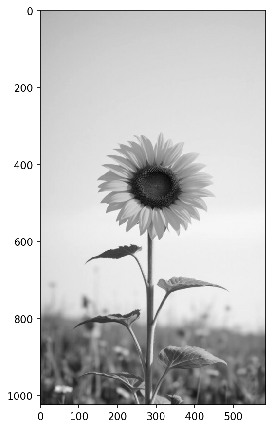

2. **Color Image Display:**
<br>
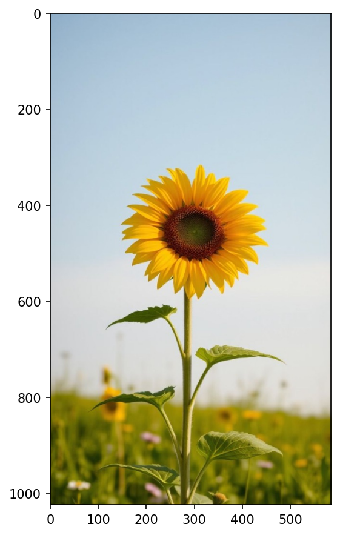

3. **Cropped Region:**
<br>
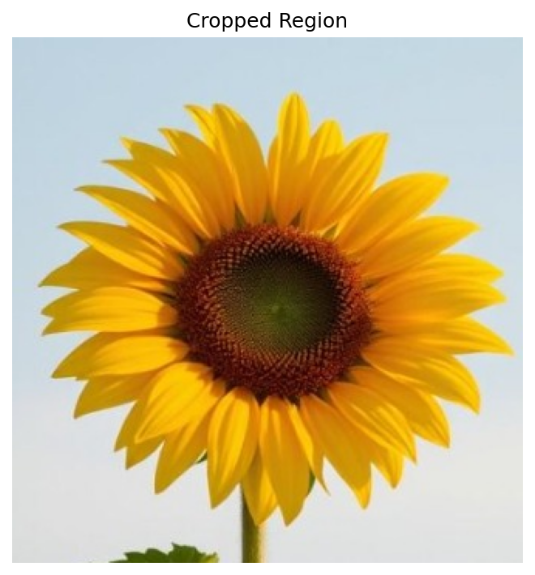

4. **Flipped Horizontally:**
<br>
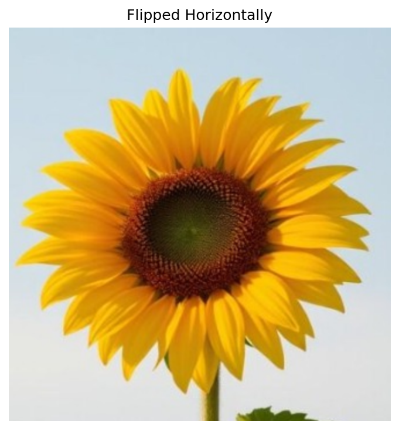

5. **Text Added on Image:**
<br>
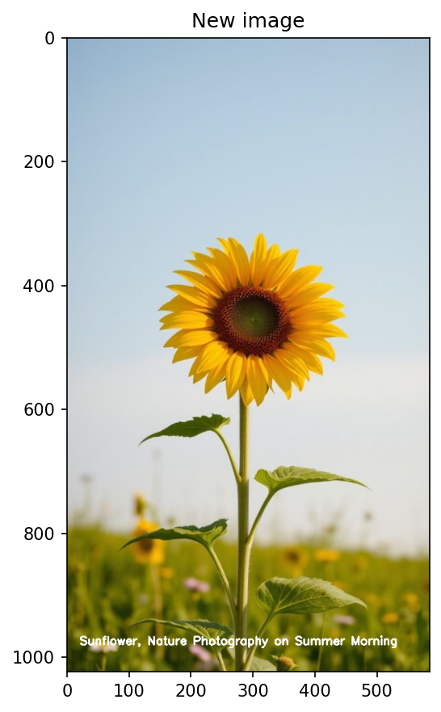

6. **Annotated Image (with Rectangle):**
<br>


---

### ii) Adjust Image Brightness:

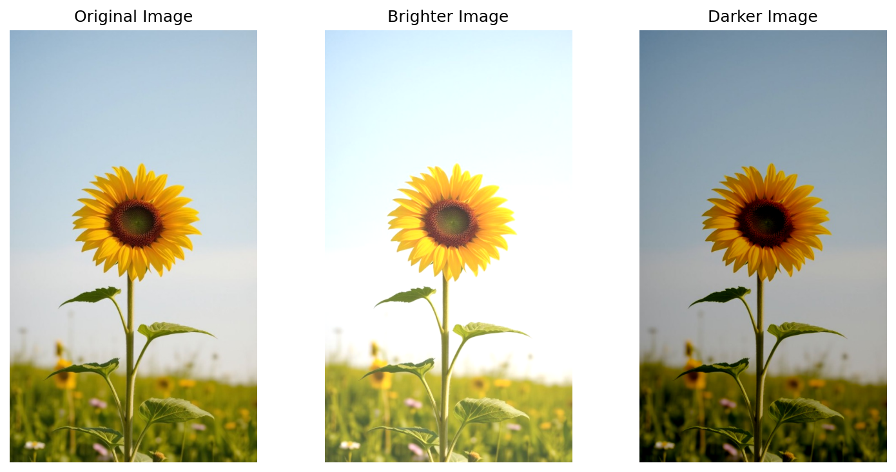

---

### iii) Modify Image Contrast:

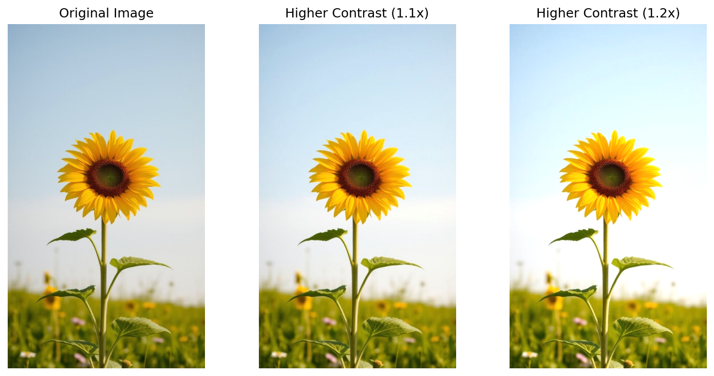

---

### iv) Channel Decomposition and Merging:

1. **Split B, G, R Channels:**
<br>
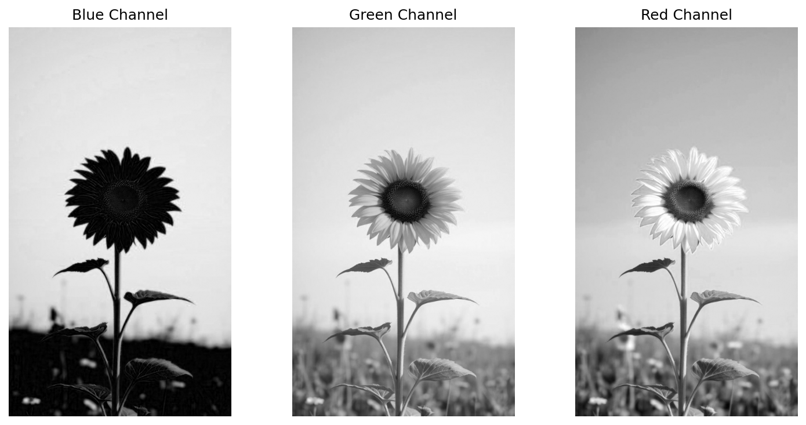

2. **Merged RGB Image:**
<br>
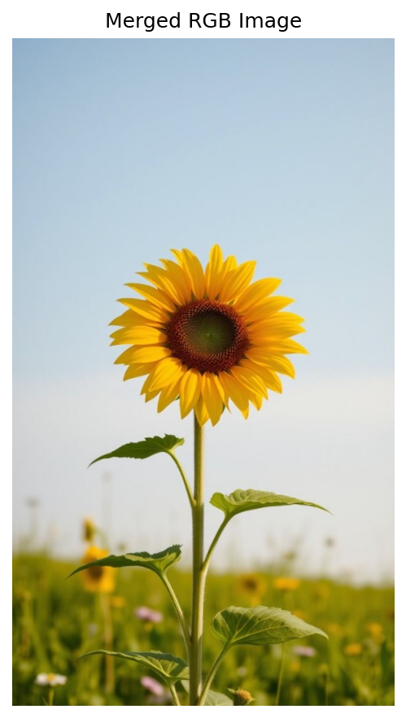

3. **Split H, S, V Channels:**
<br>
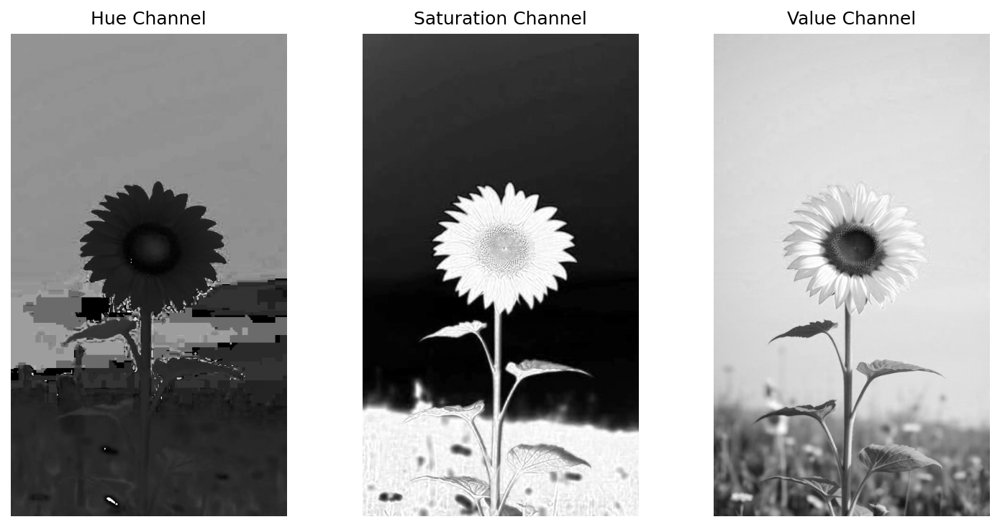

4. **Original Image & Merged HSV Image:**
<br>
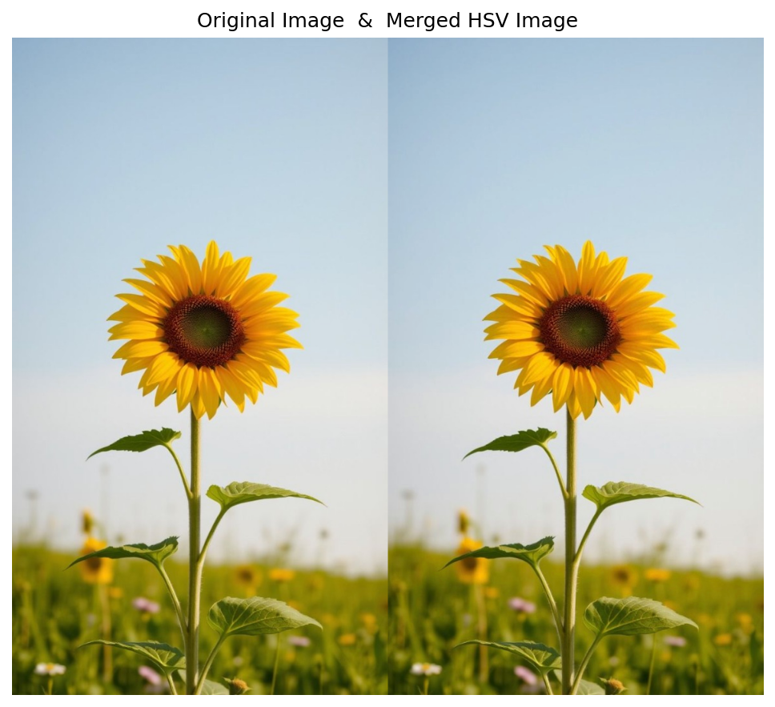

---

### v) Generate Third Image Using Bitwise Operations:

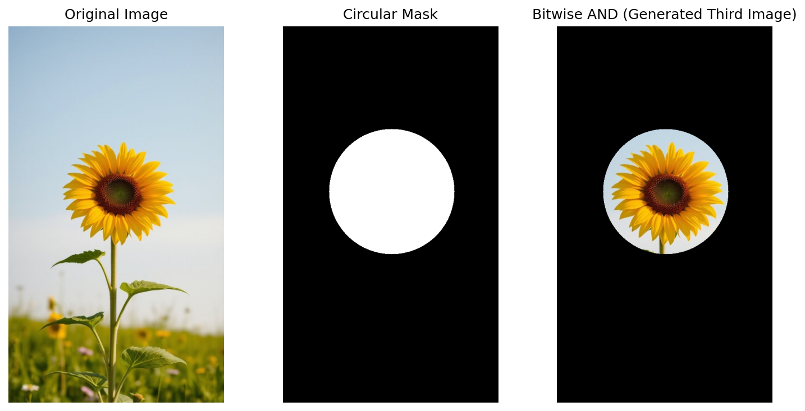

---

## Result:
Thus, the images were read, displayed, brightness and contrast adjustments were made, channel splitting and merging were performed, and bitwise operations were carried out successfully using the Python OpenCV program.
